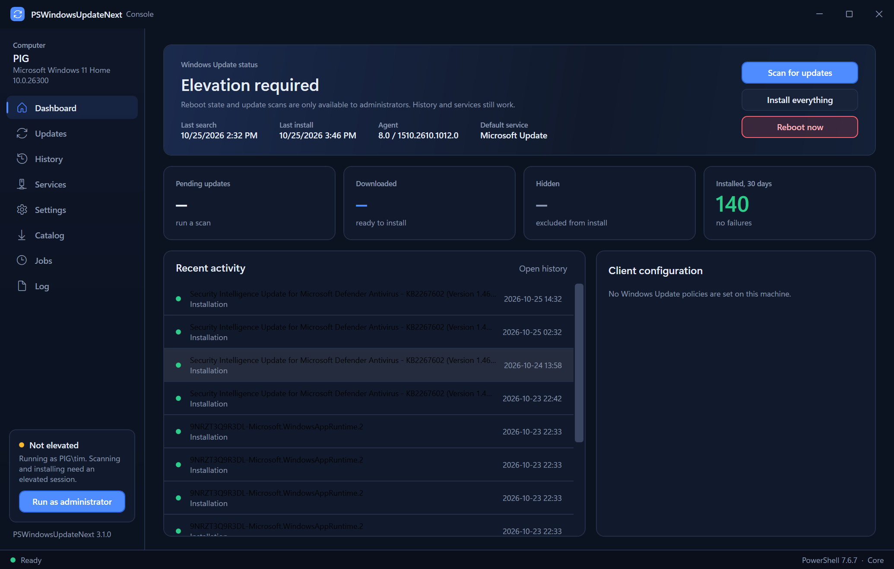
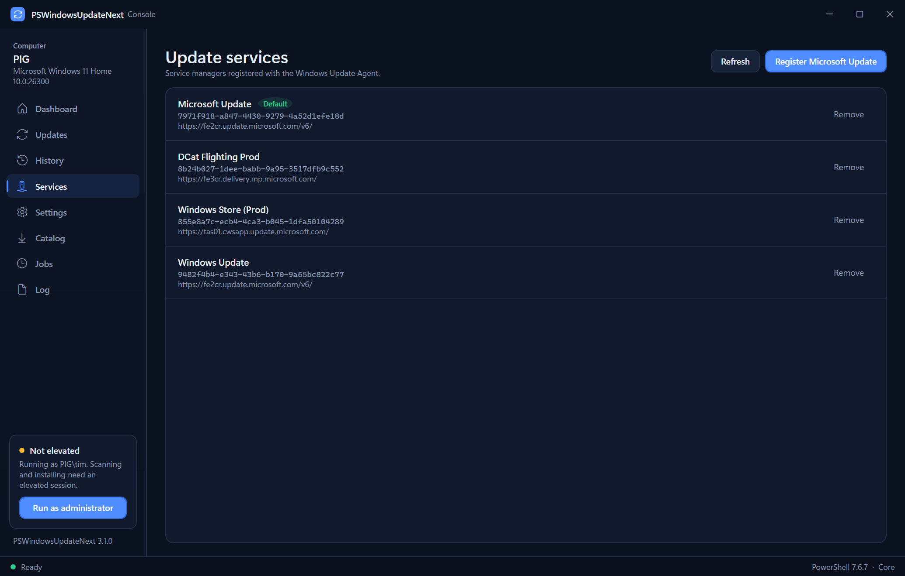

# PSWindowsUpdateNext

Cmdlets to manage the Windows Update client from PowerShell. This is a community-maintained
continuation of Michal Gajda's [PSWindowsUpdate](https://github.com/mgajda83/PSWindowsUpdate),
which has not shipped source code and whose last release was 2.2.1.5 in July 2024.

The original module was distributed only as a compiled DLL under the MIT license. This project
recovered the C# source from that DLL, committed it, and builds it for both Windows PowerShell 5.1
and PowerShell 7. All 19 cmdlets and their parameters are unchanged, so existing scripts keep working
after `Import-Module PSWindowsUpdateNext`.

## What changed from PSWindowsUpdate 2.2.1.x

Compatibility
- Runs natively in PowerShell 7.4+ (.NET 8 build) as well as Windows PowerShell 5.1 (.NET Framework 4.7.2 build). The loader picks the right binary.
- Impersonation (`-Credential`) uses `WindowsIdentity.RunImpersonated`, which exists on both runtimes.
- Source code is in the repository and builds with a plain `dotnet build`.

Fixes
- `Get-WUOfflineMSU` works again. The Catalog moved downloads to `catalog.sf.dl.delivery.mp.microsoft.com`, which the old regex never matched, and the old parser depended on the deprecated MSHTML COM engine. The new parser reads the Catalog HTML directly and downloads every file an update lists, not just the first.
- BITS downloads no longer spin a CPU core at 100 percent while waiting.
- Console prompts go through the PowerShell host instead of `Console.ReadLine`, so they work in hosts other than the console.
- Step headings in `Reset-WUComponents` are written through the host instead of raw `Console.WriteLine`.

Security
- All Catalog traffic is HTTPS only, and download URLs must be on `*.windowsupdate.com` or `*.microsoft.com`.
- Each downloaded file is checked against the SHA-1 digest the Catalog publishes. Its Authenticode signature must be valid, must not be revoked, and must chain to a Microsoft root CA, so a file signed by anyone else is rejected. Files that fail are deleted. If revocation cannot be checked because the machine is offline, a file that matched the Catalog digest is kept with a warning. `-SkipSignatureCheck` keeps failing files with a warning if you really need them.
- `Invoke-WUJob` passes the script to `powershell.exe` as `-EncodedCommand`, so quotes in `-Script` cannot alter the command line. The readable script is kept in the task description.
- `Set-PSWUSettings -SaveAsSystem` protects the SMTP credential with DPAPI (machine scope) instead of AES keyed by the current minute.
- Debug output no longer leaks the first character of supplied passwords.
- TLS 1.2 and 1.3 are enabled explicitly on .NET Framework.
- The module no longer runs `Unblock-File` across its own folder on import.
- Obsolete Code Access Security attributes and the `System.Web` dependency are gone.

## Desktop console

`Show-PSWUConsole` opens a native dark-themed window over the same cmdlets, for people who want a
power-user front end rather than a prompt. It runs in Windows PowerShell 5.1 and PowerShell 7.



- Dashboard: reboot state, last search and install, agent version, default service, 30-day install stats, recent history, and the client policy at a glance.
- Updates: scan the default service, Microsoft Update, or Windows Update; filter by text, hidden, installed, or reboot-required; select rows and download, install, hide, or unhide them; a detail panel shows description, severity, size, and the support article.
- History: the agent's operation log with result badges, count selector, and text filter.
- Services: registered service managers with Default and Managed badges, register Microsoft Update, remove a service.
- Settings: live view of the Windows Update policy keys plus a form for NoAutoUpdate, AUOptions, scheduled install day and hour, feature-update pinning, and deferral periods.
- Catalog: search catalog.update.microsoft.com by KB, pick packages, and download them with digest and Authenticode verification.
- Jobs: list the module's Task Scheduler jobs and create new ones that run as SYSTEM now, at startup, or at a set time.
- Log: every verbose, warning, and error line from the session, with copy and save.

Every operation runs in a background runspace, so the window stays responsive, and destructive
actions ask for confirmation first. If the session is not elevated the sidebar offers a one-click
restart as administrator; read-only pages still work without it.

```powershell
Import-Module PSWindowsUpdateNext
Show-PSWUConsole
```



## Install

Until the module is published to the PowerShell Gallery, download the zip from the
[Releases](https://github.com/tsvb/PSWindowsUpdateNext/releases) page or build it yourself:

```powershell
git clone https://github.com/tsvb/PSWindowsUpdateNext.git
cd PSWindowsUpdateNext
.\build.ps1 -Install
Import-Module PSWindowsUpdateNext
```

Requirements: Windows 10 / Server 2016 or later, .NET Framework 4.7.2 for Windows PowerShell, or
PowerShell 7.4 or later. Most cmdlets need an elevated session.

## Usage

The cmdlet names and parameters are the same as PSWindowsUpdate.

```powershell
# List available updates from Microsoft Update
Get-WindowsUpdate -MicrosoftUpdate

# Install everything, reboot if required
Install-WindowsUpdate -MicrosoftUpdate -AcceptAll -AutoReboot

# Hide an update
Hide-WindowsUpdate -KBArticleID KB4034658

# Update history for the last 24 hours
Get-WUHistory -MaxDate (Get-Date).AddDays(-1)

# Uninstall an update
Uninstall-WindowsUpdate -KBArticleID KB958830

# Download an offline package from the Microsoft Update Catalog
Get-WUOfflineMSU -KBArticleID 5062553 -Destination C:\Updates

# Pin feature updates to a release
Set-WUSettings -TargetReleaseVersion -TargetReleaseVersionInfo 23H2 -ProductVersion "Windows 11"
```

Function: Show-PSWUConsole (desktop console).

Cmdlets: Add-WUServiceManager, Enable-WURemoting, Get-WindowsUpdate, Get-WUApiVersion, Get-WUHistory,
Get-WUInstallerStatus, Get-WUJob, Get-WULastResults, Get-WUOfflineMSU, Get-WURebootStatus,
Get-WUServiceManager, Get-WUSettings, Invoke-WUJob, Remove-WindowsUpdate, Remove-WUServiceManager,
Reset-WUComponents, Set-PSWUSettings, Set-WUSettings, Update-WUModule.

Aliases: Install-WindowsUpdate, Download-WindowsUpdate, Hide-WindowsUpdate, UnHide-WindowsUpdate,
Show-WindowsUpdate, Uninstall-WindowsUpdate, Get-WUList, Get-WUInstall, Clear-WUJob.

## Things to know before using the remoting cmdlets

These behaviors are inherited from the original module. They are useful in a managed domain and
dangerous elsewhere, so they are called out here.

- `Enable-WURemoting -LocalAccountTokenFilterPolicy` sets `LocalAccountTokenFilterPolicy=1`, which disables UAC remote restrictions for local administrator accounts on that machine. It also sets `ForceGuest=0`, starts Remote Registry, and adds WinRM to TrustedHosts with `*`.
- `Update-WUModule -ComputerName X` copies the module to the remote machine over the administrative share (`\\X\C$\...`), then runs `Enable-WURemoting` there.
- `Invoke-WUJob` registers a Task Scheduler job that runs as SYSTEM with highest privileges. Anyone who can call it is already an administrator, but the job it creates is powerful.
- `Reset-WUComponents` stops services, renames `SoftwareDistribution` and `catroot2`, re-registers DLLs, and resets Winsock and WinHTTP proxy settings.

## Building

```powershell
dotnet build src\PSWindowsUpdateNext\PSWindowsUpdateNext.csproj -c Release
.\build.ps1            # assembles out\PSWindowsUpdateNext
Invoke-Pester .\tests  # smoke tests, run after build.ps1
dotnet test tests\PSWindowsUpdateNext.UnitTests -c Release   # C# unit tests; the DPAPI tests run on Windows only
```

Help for `Get-Help` is written as markdown in `docs/help`. After editing a page, run
`.\tools\Build-Help.ps1` to regenerate `module\PSWindowsUpdateNext.dll-Help.xml` and commit both. It needs
the `Microsoft.PowerShell.PlatyPS` module. Releases are cut by pushing a version tag; see
[docs/RELEASING.md](docs/RELEASING.md).

The project multi-targets `net472` and `net8.0-windows`. PowerShell 7 already ships the
Windows-specific runtime assemblies the module uses (System.Management, Microsoft.Management.Infrastructure,
System.ServiceProcess.ServiceController, System.Security.Cryptography.ProtectedData), so nothing
besides the module DLL is copied into the module folder.

## Contributing

See [CONTRIBUTING.md](CONTRIBUTING.md) to build, test and send changes. To report a vulnerability, follow
[SECURITY.md](SECURITY.md), which asks for a private report.

## Credits and license

Original work copyright (c) 2011-2023 Michal Gajda, released under the MIT license. If this module is
useful to you, consider [supporting the original author](https://www.paypal.com/donate/?hosted_button_id=JTUBKNG3EMEXY).
Modifications copyright (c) 2026 tsvb, same license. See [LICENSE](LICENSE).
